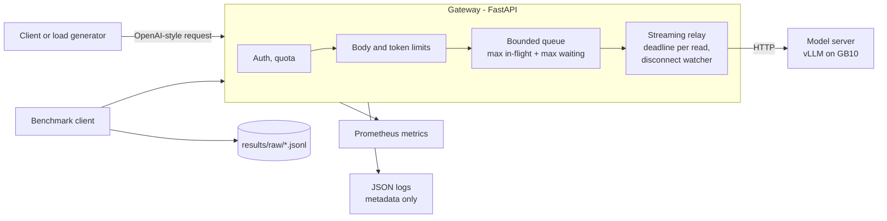

# LLM inference lab and gateway

A private, **OpenAI-compatible inference gateway** for a locally served language model, plus a
benchmark harness that records every request, successes and failures alike. The gateway's job is
to keep latency predictable under load. It does that by refusing work it can't serve
(**bounded queue, explicit rejections**), enforcing deadlines, and making sure a client that hangs
up actually stops the model from generating.

> **Status:** the gateway and benchmark tooling are complete and tested against a mock model
> server (32 tests). The real model server (vLLM, NVIDIA's DGX Spark image) runs on the GX10 host,
> because the development environment is an unprivileged container that can't run Docker. The
> container step is scripted in [RUNBOOK.md](RUNBOOK.md) § 1 but not run; **vLLM also installs with pip, and
> that path serves the pinned model on the GB10 (RUNBOOK § 1a)**. A
> llama.cpp stopgap serves the same pinned model from inside the dev container
> (`scripts/llamacpp_setup.sh`, `scripts/llamacpp_serve.sh`; details in env/ENVIRONMENT.md).
> **Baseline (2026-10-23, llama.cpp stopgap, GPU otherwise idle):** 1,800 requests, 0 errors;
> 0.46 req/s at 1.8 s median with one request in flight, 1.84 req/s at concurrency 32. Q8_0 is
> 30 % slower than Q4_K_M with no quality gain, so Q4_K_M stays
> ([EXP-01](results/summary/EXP-01-concurrency.md), [EXP-05](results/summary/EXP-05-quantization.md)).

## Architecture



Request checks run cheapest first, and nothing reaches the model unless all pass:
auth → quota → body size → JSON shape → input tokens and `max_tokens` → bounded queue → model.
The full error contract and design decisions are in [docs/01-architecture.md](docs/01-architecture.md).

## What's verified

`gateway/tests/test_gateway.py` runs real processes over TCP against a mock model server:

| Scenario | Behaviour |
| --- | --- |
| Client cancels mid-stream | Upstream generation is aborted and the slot is released, even when no tokens are flowing |
| Client gives up while queued | The request is never forwarded |
| Queue full | Immediate `429 queue_full` with `Retry-After`; waiting is capped (`503 queue_timeout`) |
| Model server killed mid-stream | The stream ends with an in-band error within seconds; new requests get a fast `502` |
| Model server hangs | The deadline is enforced (`504`, or an in-band `timeout` event for streams) |
| Oversized input or body, bad `max_tokens`, malformed JSON | A clear `4xx` and never forwarded |
| Auth and per-key quotas | Enforced and isolated per key |
| Logging | No prompts, outputs or keys in logs |

The tests are real tests: with Starlette's stock `StreamingResponse` swapped back in, both
cancellation tests fail (the upstream keeps generating). The gateway's `ManagedStreamingResponse`
is what fixes it. Overload demo against the mock: a burst of 40 requests against capacity 4 + 8
queued gave 12 served and 28 rejected in under 30 ms each, with the queue never above 8. And against the real model (llama.cpp, 4 in flight, queue 8, 2026-10-23): a 60-request burst gave 4
served, 48 rejected `429 queue_full` within 46 ms and 8 queued then `503 queue_timeout` at the 10 s
limit; with per-key quotas on (1 rps, burst 20), 40 got `429 rate_limited` within 30 ms, 8
`queue_full`, 12 served (`results/summary/overload_demo_real*.json`).

### Against a real model (llama.cpp stopgap, 2026-10-07)

`scripts/real_upstream_checks.py` → `results/summary/real_upstream_checks.json`, Qwen2.5-7B (Q4_K_M) behind the gateway:

| Check | Result |
| --- | --- |
| Client disconnects mid-stream | Server slot idle **0.4 s** later; 11 of 400 requested tokens generated, **0** after idle (generation stopped) |
| Burst of 20 vs capacity 4 + 4 queued | 8 served, **12 rejected `429` in ≤ 70 ms**, queue never above 4 |
| Model server SIGKILLed mid-stream | In-band error **10 ms** after the kill; next request `502` in 40 ms (`results/summary/real_upstream_checks.json`); server restarted |
| Input of ~5,000 tokens (exact tokenizer) | `413` before reaching the server |

Smoke benchmark (`results/summary/smoke-llamacpp-sharedgpu.md`): 40/40 requests OK, **0.95**
validator pass rate. Batching at concurrency 4 gave 19.2 output tokens/s against 5.6 at
concurrency 1, with similar per-request latency. **Not a baseline:** the GPU was ~95% busy with
other users' jobs.

## Benchmark harness

- **Prompt sets:** 100 dev + 60 held-out prompts (structured extraction, tool-call formatting, short
  reasoning), generated with known answers. Deterministic validators score quality with no judge model.
- **Load client:** async and streaming. It records TTFT, end-to-end latency, tokens, status, errors,
  validator results and system memory for every request, failures included.
- **Summariser:** p50/p95 latency and TTFT, per-request and aggregate tokens/s, successful requests/s,
  quality, and peak memory, with the metric definitions written down.

## Quick start

```bash
uv sync --extra tokenizer             # Python 3.12, versions pinned in uv.lock
uv run pytest                         # 32 tests (~40 s)
scripts/dev_stack.sh                  # mock model server :8000 + gateway :9000 (loopback)

# in another shell
uv run python -m benchmarks.client.bench --model mock --limit 20 --concurrency 1,4 --label smoke
uv run python -m benchmarks.client.summarize results/raw/*smoke*.jsonl
uv run python scripts/overload_demo.py --burst 40 --mock
```

The mock returns placeholder text, so quality scores are 0 by design.

### With a real model

1. On the host, run `scripts/host_run_vllm.sh` ([RUNBOOK.md](RUNBOOK.md) § 1), then from the development container run `scripts/check_upstream.sh`.
2. Start the gateway with `GATEWAY_UPSTREAM_URL=http://172.17.0.1:8000` and `GATEWAY_TOKENIZER_FILE=<model>/tokenizer.json`.
3. Record the background load, then run the baseline: `bench --concurrency 1,2,4,8,16 --repetitions 3 --warmup 5 --label baseline`.

### macOS (Apple silicon)

Supported for local development. Linux behaviour is unchanged, and published numbers come from the
GX10, so Mac timings aren't comparable. The macOS code paths are tested on Linux but have **not yet
been run on a real Mac**. Minimum setup:

```bash
uv sync --extra tokenizer && uv run pytest
LLAMA_SERVER=llama-server MODEL_ARGS="-hf Qwen/Qwen2.5-7B-Instruct-GGUF:Q4_K_M" CTX=8192 PARALLEL=2 scripts/llamacpp_serve.sh start
```

Memory and per-step details for a 16 GB Mac are in the portfolio's `RUN_ON_MAC_M4_16GB.md` guide.

## Repository layout

```text
gateway/          FastAPI gateway (admission, quota, limits, streaming relay, metrics) + tests
mock_upstream/    fake OpenAI-compatible server for tests and GPU-free development
benchmarks/       prompt generator and sets, validators, load client, summariser, harness tests
scripts/          dev_stack.sh (mock + gateway), overload_demo.py
env/              ENVIRONMENT.md (machine record), serve.env (model server launch config)
docs/             architecture, error contract, design decisions
```

## Configuration

All settings are `GATEWAY_*` environment variables (`gateway/config.py`): upstream URL, max
in-flight, max queue, queue timeout, request deadline, body/input/output limits, tokenizer file,
API keys, per-key quota.

## Next steps

- **vLLM container:** the image-digest path on a host with Docker (RUNBOOK § 1); the native path is done.
- **M4:** the remaining experiments (batching, prefix caching); find where throughput steps
  between concurrency 16 and 32 (EXP-01).

## Docs

- [start.md](start.md): install, tests, and the gateway, overload demo and harness against the mock. No GPU needed.
- [RUNBOOK.md](RUNBOOK.md): the steps that need the host, Docker or the GPU (vLLM on the host, the llama.cpp stopgap, real-server checks, baseline).
- [docs/README.md](docs/README.md): the design record, in reading order: [charter](docs/00-charter.md),
  [architecture](docs/01-architecture.md), [admission and limits](docs/02-admission-and-limits.md),
  [streaming and cancellation](docs/03-streaming-and-cancellation.md), [model server](docs/04-model-server.md),
  [evaluation](docs/05-evaluation.md), [roadmap](docs/06-roadmap.md), [risks](docs/07-risks.md),
  [learning checklist](docs/08-learning-checklist.md), [implementation notes](docs/09-implementation-notes.md).

Planning documents: [SPEC.md](SPEC.md) · [PLAN.md](PLAN.md)

Part of a six-project engineering portfolio. Companion projects `02-reliable-operations-agent`,
`03-permission-aware-enterprise-search` and `04-small-model-tool-use` use this gateway as their model endpoint.
