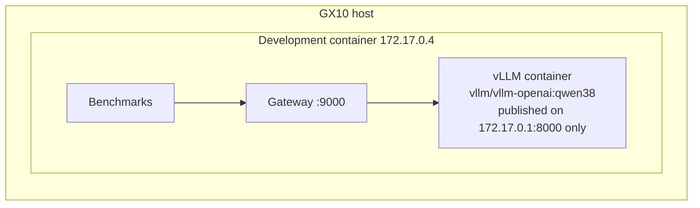

# Serving the model on the host

The development environment for this project is itself a Docker container on the GX10, and it is
**unprivileged**: Docker's default capability set (no `CAP_SYS_ADMIN`), a read-only cgroup
filesystem, and no host Docker socket. A Docker daemon cannot run inside it. The model server
therefore runs **on the host**, and the gateway in the container reaches it over the Docker bridge.

## Steps (someone with host access)

1. **Prerequisites on the host:** Docker plus the NVIDIA Container Toolkit (`docker run --gpus all`
   works), and your user in the `docker` group (`docker ps` runs without an error). This is the
   standard DGX Spark software stack.
2. **Make the model available on the host.** Pick one:
   - Download it: `hf download Qwen/Qwen2.5-7B-Instruct --revision a09a35458c702b33eeacc393d103063234e8bc28`
     (about 15 GB, Apache-2.0).
   - Copy it from the development container, which already has it:
     `docker cp <dev-container>:/root/.cache/huggingface/hub/models--Qwen--Qwen2.5-7B-Instruct ~/.cache/huggingface/hub/`
3. **Check memory.** Run `free -g` and leave room for other users' jobs. The script uses
   `GPU_MEM_UTIL=0.25` (about 30 GB of the 120 GB unified memory). Lower it if needed.
4. **Start the server:** `scripts/host_run_vllm.sh` (from this repository, on the host). It prints the
   image digest: record it in `env/ENVIRONMENT.md`.
5. **From the development container:** `scripts/check_upstream.sh` should show health 200, the
   model list, and a short reply.
6. **Stop:** `scripts/host_run_vllm.sh stop`

## Why these settings differ from NVIDIA's playbook

NVIDIA's DGX Spark vLLM playbook serves a 27B model with `--gpu-memory-utilization 0.7` on
`0.0.0.0:8000`. This project:
- uses a 7B model (the plan's 3–8B range);
- takes a smaller memory share, because the machine is shared;
- publishes only on the bridge address, keeping the model private;
- disables prefix caching for the baseline (one experiment enables it);
- enables Hermes-style tool-call parsing, which the operations-agent and tool-use projects need.

Benchmarks are only valid as baselines when the GPU isn't busy with other jobs. Record
`nvidia-smi` before each run.
