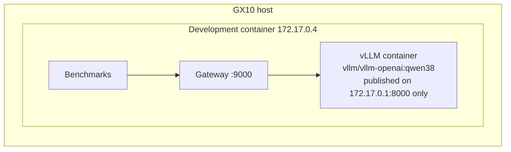

# Runbook — the steps that need the host, Docker or the GPU

Everything in [start.md](start.md) runs on CPU against the mock. This file covers the rest: the
steps that need the GX10 host, Docker, the GPU, or a model on disk. They are listed in order, each
with what it unblocks. Status as of 2026-10-23: § 2–4 have been run on the stopgap (2026-10-07).
**§ 1 and § 5 have never been run.**

| § | Step | Needs | Status |
|---|---|---|---|
| 1 | Serve the model on the host with vLLM | host shell, Docker + NVIDIA Container Toolkit | scripted, not run |
| 2 | Serve the stopgap with llama.cpp in the dev container | GPU, the cached model, network for the clone | running |
| 3 | Put the gateway in front of a real model | § 1 or § 2 | done on § 2 |
| 4 | Behaviour checks against the real server | § 2 (the script is llama.cpp-specific) | done, `results/summary/real_upstream_checks.json` |
| 5 | Baseline benchmark | § 1, a quiet GPU window | not run |

**Before any GPU step on the shared machine:** run `nvidia-smi` and `free -g`, and write the
result down. Other users' jobs share the GPU and the unified memory (`env/ENVIRONMENT.md`).

---

## 1. Serving the model on the host (vLLM) — closes M1

The development environment for this project is itself a Docker container on the GX10, and it is
**unprivileged**: Docker's default capability set (no `CAP_SYS_ADMIN`), a read-only cgroup
filesystem, and no host Docker socket. A Docker daemon cannot run inside it. The model server
therefore runs **on the host**, and the gateway in the container reaches it over the Docker bridge.



### Steps (someone with host access)

1. **Prerequisites on the host:** Docker plus the NVIDIA Container Toolkit (`docker run --gpus all`
   works), and your user in the `docker` group (`docker ps` runs without an error). This is the
   standard DGX Spark software stack.
2. **Make the model available on the host.** Pick one:
   - Download it: `hf download Qwen/Qwen2.5-7B-Instruct --revision a09a35458c702b33eeacc393d103063234e8bc28`
     (about 15 GB, Apache-2.0).
   - Copy it from the development container, which already has it:
     `docker cp <dev-container>:/root/.cache/huggingface/hub/models--Qwen--Qwen2.5-7B-Instruct ~/.cache/huggingface/hub/`
3. **Check memory.** Run `free -g` and leave room for other users' jobs. The script uses
   `GPU_MEM_UTIL=0.25` (about 30 GB of the 120 GB unified memory). Lower it if needed.
4. **Start the server:** `scripts/host_run_vllm.sh` (from this repository, on the host). It prints the
   image digest: record it in `env/ENVIRONMENT.md`.
5. **From the development container:** `scripts/check_upstream.sh` should show health 200, the
   model list, and a short reply.
6. **Stop:** `scripts/host_run_vllm.sh stop`

### Why these settings differ from NVIDIA's playbook

NVIDIA's DGX Spark vLLM playbook serves a 27B model with `--gpu-memory-utilization 0.7` on
`0.0.0.0:8000`. This project:
- uses a 7B model (the plan's 3–8B range);
- takes a smaller memory share, because the machine is shared;
- publishes only on the bridge address, keeping the model private;
- disables prefix caching for the baseline (one experiment enables it);
- enables Hermes-style tool-call parsing, which the operations-agent and tool-use projects need.

Benchmarks are only valid as baselines when the GPU isn't busy with other jobs. Record
`nvidia-smi` before each run.

### After it works

- Record the image digest **and the vLLM version** in `env/ENVIRONMENT.md` (both are `TBD`), and
  pin the digest in `env/serve.env` (`VLLM_IMAGE`).
- `scripts/host_run_vllm.sh` waits up to 10 minutes for `/health`. If it fails, it prints
  `docker logs inference-lab-vllm` as the next thing to read.
- `scripts/check_upstream.sh` fails if the model list lacks `qwen2.5-7b-instruct`. Health alone is
  not enough, because another service on the same port can answer it
  ([docs/04-model-server.md](docs/04-model-server.md) § Two traps). Override the URL with
  `UPSTREAM=...`.
- `host_run_vllm.sh` does not read `env/serve.env`. If you change a launch argument in one, change
  it in the other ([docs/07-risks.md](docs/07-risks.md) § R8).
- **M1 exit:** tear it down, follow the README from scratch, and confirm it comes up again (PLAN M1).

---

## 2. Serving the stopgap (llama.cpp, inside the dev container)

Used until § 1 is done. The companion projects reach it through the gateway, so **stopping or
crashing it interrupts them**.

```bash
scripts/llamacpp_setup.sh          # clone tag b11439, build llama-server, convert + quantise to Q4_K_M
CUDA_CACHE_MAXSIZE=4294967296 scripts/llamacpp_serve.sh start   # 127.0.0.1:21000, 4 slots x 4,096 tokens
scripts/llamacpp_serve.sh status
scripts/llamacpp_serve.sh stop
```

- The setup script expects the pinned snapshot in the HF cache (`$HF_HOME`, default
  `~/.cache/huggingface`). It writes only to `.tools/` and `models/`, both gitignored, and records
  the GGUF hash in `models/SHA256SUMS`. Compare it against the sha256 in `env/ENVIRONMENT.md`.
- **Build flags: [verify].** The script passes `-DCMAKE_CUDA_ARCHITECTURES=120`. The working build
  recorded in `env/ENVIRONMENT.md` used `-DCMAKE_CUDA_ARCHITECTURES=OFF
  -DCMAKE_CUDA_FLAGS=-gencode=arch=compute_120,code=compute_120`. If requests fail with "no kernel
  image is available", rebuild with the recorded flags
  ([docs/09-implementation-notes.md](docs/09-implementation-notes.md) § 5).
- The first request after start is slow, because the PTX is JIT-compiled. `CUDA_CACHE_MAXSIZE`
  keeps the compiled kernels between starts.
- Overrides: `PORT`, `CTX` (total context, shared by the slots), `PARALLEL`, `LLAMA_SERVER`,
  `MODEL_ARGS`. Logs go to `.run/llama-server.log`.

---

## 3. Gateway in front of a real model

```bash
# stopgap (§ 2)
GATEWAY_UPSTREAM_URL=http://127.0.0.1:21000 \
GATEWAY_TOKENIZER_FILE=$HOME/.cache/huggingface/hub/models--Qwen--Qwen2.5-7B-Instruct/snapshots/a09a35458c702b33eeacc393d103063234e8bc28/tokenizer.json \
GATEWAY_MAX_INFLIGHT=4 \
uv run uvicorn --factory gateway.app:create_app_from_env --host 127.0.0.1 --port 9000
```

For vLLM (§ 1), use `GATEWAY_UPSTREAM_URL=http://172.17.0.1:8000`. Set `GATEWAY_MAX_INFLIGHT` no
higher than the server's concurrent capacity: 4 for the stopgap's slots, at most 16 for vLLM's
`--max-num-seqs` ([docs/02-admission-and-limits.md](docs/02-admission-and-limits.md) § Sizing).
Then check `curl -sS http://127.0.0.1:9000/readyz`. Note that it checks only the upstream's
`/health`.

---

## 4. Behaviour checks against the real server

```bash
uv run python scripts/real_upstream_checks.py --upstream http://127.0.0.1:21000          # basics, oversized, cancellation, overload
uv run python scripts/real_upstream_checks.py --upstream http://127.0.0.1:21000 --crash  # + SIGKILL and restart the server
```

- The script starts its own gateway on port 21090 (4 running + 4 queued, 3,500 input tokens) and
  **overwrites `results/summary/real_upstream_checks.json`**. Commit the new file only if you mean
  to replace the 2026-10-07 record.
- `--crash` SIGKILLs the PID in `.run/llama-server.pid`, then restarts the server with
  `CUDA_CACHE_MAXSIZE` set. Warn the companion projects first.
- It reads the tokenizer from the pinned HF snapshot path, and it calls `nvidia-smi`.
- **It is llama.cpp-specific.** Cancellation and oversize checks read
  `llamacpp:tokens_predicted_total` and `/slots`. Against vLLM it fails with "is this llama.cpp?".
  The vLLM version of the cancellation check (PLAN M3: vLLM's running-requests metric) has not
  been written.

---

## 5. Baseline benchmark — closes M2

Prerequisites: § 1 running, a benchmark window agreed with the owners of the background jobs
(PLAN M0), and the protocol items still open in PLAN M2 settled: the output budget, the stop
conditions, and the cache state ([docs/05-evaluation.md](docs/05-evaluation.md) § Protocol).

```bash
nvidia-smi; free -g                                           # record both with the run
uv run python -m benchmarks.client.bench --model qwen2.5-7b-instruct \
  --concurrency 1,2,4,8,16 --repetitions 3 --warmup 5 --store-output --label baseline
uv run python -m benchmarks.client.summarize results/raw/*-baseline.jsonl --out results/summary/baseline
```

- `bench` defaults to the gateway at `http://127.0.0.1:9000` (§ 3) and to `benchmarks/prompts/dev.jsonl`.
  Run `heldout.jsonl` (`--prompts`) only for final quality checks, never for tuning.
- `--store-output` keeps the model text for failure analysis. `summarize --out` writes `.md` and
  `.csv` side by side.
- Never compare against a run taken under different background load. The smoke run is not a
  baseline.

---

## What this unblocks

| Step | Unblocks |
|---|---|
| § 1 | S6 (reproducible endpoint), the image digest, vLLM cancellation (S2 on vLLM), everything in § 5 |
| § 4 on vLLM | the last open M3 item |
| § 5 | M2 exit, M4 Exp 1 (which sets the gateway limits), S8, and real numbers in the README |
