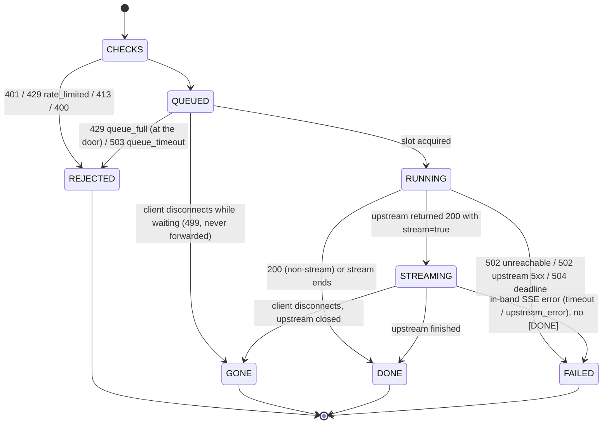

# 01 — Architecture

The gateway is one FastAPI process between clients and one OpenAI-compatible model server. This
doc covers what happens to a single request between arriving and giving its slot back:
[02](02-admission-and-limits.md) goes deeper on admission and limits, and
[03](03-streaming-and-cancellation.md) on streaming and cancellation.

## Request path

```text
                      ┌──────────────────────────── gateway (FastAPI, :9000) ──────────────────────────┐
benchmark client ───► │ auth → quota → body size → JSON shape → input tokens / max_tokens → bounded queue │ ───► model server
overload demo         │      401      429         413          400            413 / 400          429 / 503    │      (vLLM, :8000)
                      │                                                                                 │          │
                      │  streaming relay: deadline per read, disconnect watcher, always closes upstream │       GB10
                      └───────────┬───────────────────────────────────┬─────────────────────────────────┘
                                  │ JSON log line per request         │ /metrics (Prometheus)
                                  ▼ (metadata only)                   ▼
```

All checks run before a request can occupy model capacity, cheapest first.

The diagram names the *planned* upstream (vLLM on `:8000`). Today the upstream is the llama.cpp
stopgap on `127.0.0.1:21000` ([04](04-model-server.md)). The gateway code is the same for both;
only `GATEWAY_UPSTREAM_URL` changes.

## The three rules that make this design worth writing down

**Rule 1: nothing reaches the model until every cheap check has passed.** Model capacity is the
scarce resource. A malformed or oversized request should cost a JSON parse or a tokenizer pass,
not a slot. Against the real server, a ~5,000-token input was rejected with `413` and the
server's generated-token counter did not move (`results/summary/real_upstream_checks.json` →
`oversized.server_untouched: true`).

**Rule 2: capacity is bounded twice, and the bound is explicit.** At most `max_inflight`
requests run against the server and at most `max_queue` wait. Anything beyond that gets `429
queue_full` immediately, and anything that waits too long gets `503 queue_timeout`. The client
always learns its fate in bounded time. That is the difference between overload and a hang
([02](02-admission-and-limits.md)).

**Rule 3: every exit path gives the slot back and closes the upstream.** `Ticket.release()` and
`StreamSession.close()` are idempotent, so every path can call them without bookkeeping, and the
cleanup in `ManagedStreamingResponse` runs in a shielded `finally`. In LLM serving, a leaked slot
is a GPU generating tokens for nobody, so leaks are treated as correctness bugs, not resource
hygiene ([03](03-streaming-and-cancellation.md)).

## One request, as a state machine



The slot is held only in `RUNNING` and `STREAMING`. Every transition out of those two states
releases it: `proxy_once` in a `finally`, `start_stream` on each early-return path, and
`StreamSession.close()` for streams. Each terminal state writes exactly one log line and
increments `gateway_requests{outcome=...}` once (`finish()` in `gateway/app.py`).

## Error contract

| Situation | Status | `error.type` | Retry-After |
| --- | --- | --- | --- |
| Missing/invalid API key | 401 | `unauthorized` | – |
| Per-key quota exceeded | 429 | `rate_limited` | yes |
| Body over byte limit | 413 | `body_too_large` | – |
| Malformed JSON / messages | 400 | `invalid_json` / `invalid_request` | – |
| Input over token limit | 413 | `input_too_large` (states size and limit) | – |
| `max_tokens` out of range | 400 | `invalid_max_tokens` | – |
| Wait queue full | 429 | `queue_full` | yes |
| Waited too long for a slot | 503 | `queue_timeout` | yes |
| Model server unreachable | 502 | `upstream_unavailable` | – |
| Model server 5xx | 502 | `upstream_error` | – |
| Model server 4xx | passed through | upstream's body | – |
| Deadline before first byte | 504 | `timeout` | – |
| Deadline / upstream failure mid-stream | 200 then SSE `data: {"error": ...}`, no `[DONE]` | `timeout` / `upstream_error` | – |

Once a stream has started, the HTTP status is already sent, so mid-stream failures are signalled
in-band. A stream without `[DONE]` is never a success; the benchmark client counts it as an error.

## Decisions

**Bounded queue with immediate rejection.** Under overload an unbounded queue turns every request
into a slow one and eventually exhausts memory. Rejecting at the door keeps latency for admitted
requests predictable and tells clients to back off. `max_inflight` should come from the measured
concurrency knee (Exp 1), not a guess.

**Disconnect handling is explicit.** Starlette 1.x `StreamingResponse` (ASGI spec ≥ 2.4) only
notices a disconnect when a send fails, never closes the body iterator, and skips background tasks
on disconnect. Measured consequence (mutation test, 2026-10-06): with the stock class, both
cancellation tests fail — the upstream generation keeps running. `ManagedStreamingResponse`
watches for `http.disconnect` concurrently and always closes the upstream response, which makes
vLLM abort the sequence.

*Added note.* Two parts of that paragraph are not backed by a committed result. Abort on vLLM has
never been observed: the abort was measured on llama.cpp only. **[verify]** whether the
mutation-test result still holds with the pinned `uvicorn` 0.54.0 and `starlette` 1.7.0
(`uv.lock`) when the stock class is given a background close task, not just swapped in bare
([09](09-implementation-notes.md) § 1).

**Leaving the queue.** A client that disconnects while queued gives up its place and is never
forwarded. Without this, clients that time out and retry create ghost work exactly when the
system is most overloaded.

**Deadline covers everything.** One per-request deadline spans queueing, connect, and every
streamed read, so a hung model server cannot pin a slot indefinitely.

**Logs are allow-listed.** Request logs contain only fixed metadata fields
(`LOG_FIELDS` in `gateway/app.py`). Keys are logged as a short hash prefix. This is enforced by
construction and checked by a test that searches the log for prompt, output, and key sentinels.

**Token counting.** With `GATEWAY_TOKENIZER_FILE` set, input limits use the model's tokenizer
(plus a small per-message allowance for the chat template). Without it, a chars/4 heuristic is
used. The model server still enforces its own context length, and its 4xx is passed through.

## Known limitations

- A non-streaming request whose client disconnects *after* being forwarded still runs to
  completion upstream (disconnects are only watched while queued and while streaming).
- Quota and queue state are in-process: one gateway replica only. Multiple replicas would need a
  shared store; that is out of scope for v1.
- Disconnect detection while queued relies on the server delivering `http.disconnect` (uvicorn
  does). Behind a proxy that buffers requests, detection may be delayed.
- `/readyz` asks only the upstream's `/health`. On this machine port 8000 is answered by an
  unrelated service (`env/ENVIRONMENT.md`), which is why `scripts/check_upstream.sh` and
  `scripts/llamacpp_serve.sh` require the model id in `/v1/models`. `/readyz` does not, so a
  wrong `GATEWAY_UPSTREAM_URL` can still report ready.
- The gateway exposes `/metrics`, but the Prometheus server and Grafana dashboards planned in
  PLAN (`monitoring/`, `env/compose.yaml`) do not exist yet.

## Components

| Module | Responsibility | Tested by (`gateway/tests/test_gateway.py`) |
|---|---|---|
| `gateway/app.py` | Request IDs, check order, slot acquisition with disconnect watch, proxying, `/healthz` `/readyz` `/metrics`, allow-listed logging | all 24 tests |
| `gateway/admission.py` | `AdmissionController` (semaphore + waiting counter), idempotent `Ticket` | `test_queue_saturation_*`, `test_queue_wait_*`, `test_client_leaving_the_queue_*` |
| `gateway/streaming.py` | `ManagedStreamingResponse`, `StreamSession` (deadline per read, in-band errors, usage capture) | `test_client_cancel_*`, `test_upstream_crash_*`, `test_hung_upstream_hits_deadline_stream` |
| `gateway/quota.py` | Per-key token bucket | `test_per_key_quota` |
| `gateway/tokens.py` | Exact (tokenizer) or chars/4 input-token count | `test_oversized_input_rejected_before_upstream` |
| `gateway/errors.py` | `GatewayError` → OpenAI-style body, `X-Request-ID`, `Retry-After` | every rejection test |
| `gateway/metrics.py` | Prometheus registry with low-cardinality labels | not asserted by a test |
| `gateway/config.py` | `Settings` from `GATEWAY_*` environment variables | via the fixtures in `gateway/tests/conftest.py` |
| `mock_upstream/server.py` | Fake OpenAI-compatible server. A per-request `mock` field sets `ttft_s`, `token_delay_s`, `hang`, `status`. `/stats` counts active, started, completed and aborted generations | the oracle the gateway tests assert against |

The tests start real processes (mock and gateway, each a uvicorn on a free loopback port) and talk
to them over TCP. The fixture docstring gives the reason: cancellation, disconnects and crashes
only behave realistically over real connections, not through an in-process ASGI transport.

## Endpoints

| Endpoint | Behaviour |
|---|---|
| `POST /v1/chat/completions` | The checked, admitted, proxied request described above |
| `GET /healthz` | Always 200 while the process is up: `{"status", "inflight", "waiting"}`. The overload demo and the tests poll it to observe queue depth |
| `GET /readyz` | 200 if the upstream `/health` answers 200 within 2 s, otherwise 503 |
| `GET /metrics` | `gateway_requests{outcome}`, `gateway_request_seconds{stream}`, `gateway_ttft_seconds`, `gateway_inflight`, `gateway_queue_waiting` |

## Configuration

All settings are `GATEWAY_*` environment variables, read once at start-up (`gateway/config.py`).

| Variable | Default | Meaning |
|---|---|---|
| `UPSTREAM_URL` | `http://127.0.0.1:8000` | Model server base URL |
| `UPSTREAM_API_KEY` | unset | Sent as `Bearer` to the server, if it has `--api-key` |
| `MAX_INFLIGHT` / `MAX_QUEUE` | 8 / 32 | Admission bounds ([02](02-admission-and-limits.md)) |
| `QUEUE_TIMEOUT_S` | 10 | Longest wait for a slot |
| `REQUEST_TIMEOUT_S` | 120 | Total deadline, from receipt to last byte |
| `CONNECT_TIMEOUT_S` | 2 | Connect timeout to the server |
| `MAX_BODY_BYTES` | 1,000,000 | Body size limit |
| `MAX_INPUT_TOKENS` / `MAX_OUTPUT_TOKENS` | 4096 / 1024 | Token limits. A missing `max_tokens` is filled in with the output limit |
| `TOKENIZER_FILE` | unset | Path to `tokenizer.json` for exact counts |
| `API_KEYS` | empty (auth off) | Comma-separated keys. Leave auth off only on a loopback-bound dev server |
| `QUOTA_RPS` / `QUOTA_BURST` | 0 (off) / 10 | Per-key token bucket |

## Repository layout

```text
01-llm-inference-lab/
├── gateway/              FastAPI gateway (modules above)
│   └── tests/            conftest.py (process fixtures) + test_gateway.py (24 tests)
├── mock_upstream/        fake model server for tests and GPU-free development
├── benchmarks/
│   ├── prompts/          generate.py → dev.jsonl (100), heldout.jsonl (60)
│   ├── validators/       json_equals, final_integer
│   ├── client/           bench.py (load client), summarize.py
│   └── test_benchmarks.py  8 harness tests
├── scripts/              dev_stack.sh, overload_demo.py, real_upstream_checks.py,
│                         llamacpp_setup.sh, llamacpp_serve.sh, host_run_vllm.sh, check_upstream.sh
├── env/                  ENVIRONMENT.md (machine record), serve.env (launch config)
├── results/raw/          per-request JSONL, one file per run
├── results/summary/      summaries (.md/.csv) and real_upstream_checks.json
├── docs/                 these documents
├── start.md  RUNBOOK.md
└── SPEC.md  PLAN.md  README.md
```

This differs from PLAN's target layout in four places. Tests live next to their code. There is no
`env/compose.yaml`, no `monitoring/` and no `benchmarks/configs/`. The gateway is a flat
`gateway/` package instead of `gateway/app/`. The reasons are in
[09](09-implementation-notes.md) § 8. `.tools/`, `models/`, `.run/` and `.venv/` are gitignored:
the llama.cpp build, the GGUF files, PID files and server logs never enter the repository.
